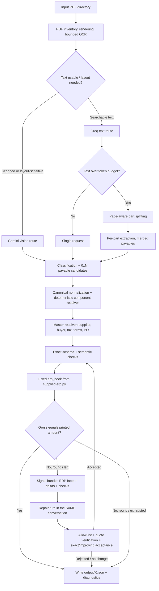

# Architecture — Evidence-driven Bookable Payable AI

## Goals and invariants

The pipeline turns an input PDF into the candidate kit's exact output (`file`, `payables`, `declined`) with one strict autodraft per bookable payable. It is designed to maximize correct booking while preferring explicit, flagged uncertainty over unsupported financial facts.

Non-negotiable invariants:

- `erp.py` is imported and used unchanged; its behavior is also mirrored (self-checked) inside `signals.py` for *introspection only*, and the mirror refuses to emit a trace unless it agrees with the sealed calculator to the cent.
- The LLM proposes facts and owns judgment; deterministic Python owns normalization, the component resolver, master lookups, schema checks, quality checks, reconciliation, repair grounding, and acceptance.
- A printed gross is an observation, never a field the model or the repair loop may manipulate.
- Every accepted accounting change is source-quoted, field-context-verified, schema-clean, and either strictly improves reconciliation (value edits) or lands **exactly** on the printed gross (removals).
- A matching gross is necessary but not sufficient; a tax is represented exactly once, at the level the document states it.
- Processing failures are logged as failures. An empty placeholder output is not a successful extraction.

## System flow

## Module responsibilities

| Module | Responsibility | Important boundary |
|---|---|---|
| `payable_ai/pdf_io.py` | Embedded-text extraction, page images, bounded/concurrent OCR with auto-discovery of the Tesseract binary, page-aware trimming, page-aware splitting for token-limited routes | OCR is noisy; confidence is a routing signal, never proof |
| `payable_ai/keys.py` | Key pools (any count/format), health states (ready / cooling / invalid), rotation, pacing, secret redaction | A key value never reaches a log line; auth-invalid keys are dropped, quota-limited keys cool for the provider's own retry window |
| `payable_ai/llm.py` | Provider + model ladder, per-model caps, chunked text route with conservative merge, warm-conversation repair, error classification (invalid / quota / request / transient) | Rotation is availability, not consensus; correctness is decided by the deterministic layer |
| `payable_ai/prompting.py` | Stable-prefix extraction reference; signal-driven repair rules; clear/removal protocol | Documents are untrusted data; prompts state _how the ERP computes_ and translation rules, never per-document answers |
| `payable_ai/signals.py` | ERP trace (per-line bases, per-tax contributions and bases, charges) + fact signals (gross delta, line-vs-printed deltas, declared-vs-component tax) | Facts only — no remedies; the trace is withheld if it disagrees with the sealed calculator |
| `payable_ai/normalization.py` | Number/date/currency normalization, credit semantics, schema shape | Never synthesizes a missing amount |
| `payable_ai/validation.py` | Schema checks, reconciliation, grounded repair semantics, component resolver | Removals require exact reconciliation; the resolver fires only on math-certain, non-tax-inclusive rows |
| `payable_ai/master_data.py` | Indexed master-data resolution | Unmatched/ambiguous codes stay blank; no generated IDs |
| `payable_ai/quality.py` | Semantic checks: line extension vs components, tax at both levels, declared vs component tax, missing evidence | Warnings trigger review; they never auto-correct money |
| `payable_ai/evidence.py` | Verifies model-returned source quotes against page text | Visual-only evidence is reported as unverified, not assumed |
| `payable_ai/pipeline.py` | Orchestration, the bounded converge loop, determinism-boundary resolver application, diagnostics, output writing | Errors are never counted as completed payables |
| `main.py` | CLI: run, `--only`, `--limit`, `--provider`, `--diagnose`, `--check-config --probe-keys`, `--validate-output` | Offline validation makes no API calls |

## The repair loop in detail

1. Normalize the candidate; restore any component the printed row arithmetic pins uniquely; schema + quality + ERP reconcile.
2. If the gross disagrees: build the signal bundle (facts from the ERP trace, deltas, declared-vs-component tax, semantic check codes).
3. Repair turn **inside the same conversation** (Gemini keeps the page images and its own draft in context — no re-upload, stable prefix, cache-friendly). On provider switch, a cold repair prompt carries the truncated source text instead.
4. Parse each proposed change against the scalar allow-list. Value edits must be quote-grounded (the proposed number must appear on the page, in the right field context, nearest the right label). Removals require only label-context grounding but are accepted only when the corrected draft reproduces the printed gross **exactly**.
5. Trial-normalize the candidate; accept only if it stays schema-clean and does not add critical semantic errors, and either reconciliation lands on MATCH or the absolute difference strictly decreases.
6. Termination: MATCH, no accepted change, or `REPAIR_ROUNDS` (default 2). Every round is logged with its signals and outcome, so a reviewer can see convergence (or its absence) rather than a black box.

## Prompt assembly (cache and attention)

- Every call is `[stable prefix][variable tail]`: system instruction + extraction reference (byte-stable across all documents) precede filename, document text, draft and task.
- The item to act on (page text, or the draft under repair with its facts) sits at the **bottom** of the turn, where attention is most reliable.
- Extraction and repair share one conversation per document, so the provider's implicit prefix cache can hit on the static prefix and the repair turn pays only for its delta.

## Provider routing and quota engineering

`PAYABLE_AI_PROVIDER=auto` prefers Gemini when the document needs layout reasoning, Groq when text suffices. A configured provider can be forced. The key pool and model ladder make free-tier realities survivable: per-key health, per-model daily-bucket rollover, per-minute pacing, request-class errors (too-large) routed to the next model instead of killing a key, and fast failure — a cooling provider is skipped when an alternative exists instead of sleeping through a daily quota. Diagnostics record attempts (`provider_attempts`) so routing decisions are auditable.

## Production gap analysis

Before handling real supplier payments: a curated labeled evaluation set with per-field metrics; versioned prompts/models with shadow evaluation; a queue-based, idempotent batch runner; token/request budgets per tenant; OCR-text caching keyed by document hash; encrypted storage, retention limits, and access controls; a provider data-processing arrangement (free tiers are not acceptable for confidential invoices); a human-review queue for every non-MATCH, every removed component, and every low-confidence visual read; and immutable audit events for every accepted change. Model output must never auto-approve a payment without business controls.
